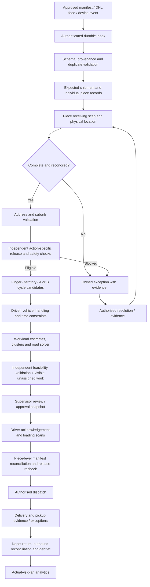
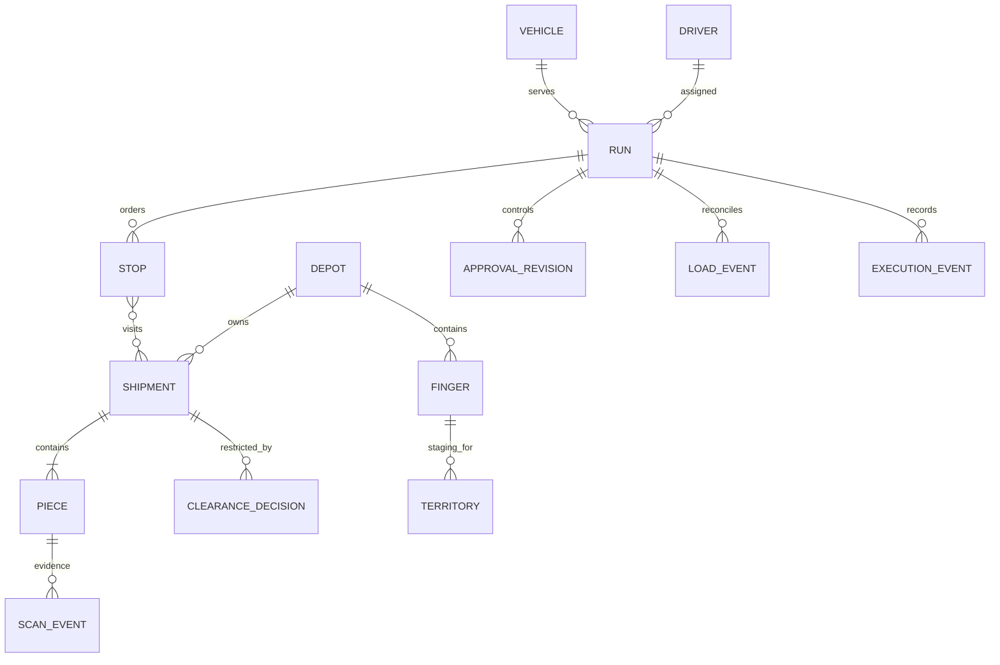

# IFOROS engineering review and execution baseline

14 October 2026 · Current local DEVELOPMENT checkout · synthetic development only

Controlling input: the user's new Master Engineering Directive. This report preserves the existing code rather than proposing an unrelated replacement. Responsibilities below describe engineering functions; no claim is made that 25 independent engineers performed this audit.

## Part A — Existing system assessment

### Repository evidence

The local origin matches `RusheetB567/DHL---Load-Balancer-Planner`. Local HEAD is `d0e6b7c34ffd75b4961a26a136606ffe43b70b86`, matching the advertised DEVELOPMENT branch. Remote master is `7c920b71700aacb6e656b17ba9b4118582a6c636`; LIVE is `e20d2b1582ac31606bb9d69e739e9e02279d7a2b`. Remote refs were read, not changed. This audit concerns local DEVELOPMENT plus existing uncommitted changes; master/LIVE source was not independently reviewed.

Baseline executed: `npm test` passes 18 tests; `npm run check` passes. Tests establish particular scenarios, not production readiness. Browser visual verification of the most recent UI/cycle changes remains pending because prior browser automation was blocked.

| Area | Verified implementation | Gaps / required correction |
| --- | --- | --- |
| Stack | Node 24 REST modular services, built-in SQLite, plain browser JS/CSS, locally served ZXing | No TypeScript contract checking, OpenAPI validation, deployment pipeline or production database |
| Freight | Atomic CSV/JSON imports, CisDriver field mapping, unique individual barcodes, dimensions/totals | Excel, approved DHL APIs, source revision reconciliation and structured classification absent |
| Receiving | Physical location, duplicate/unknown exceptions, reconciliation, idempotency | Scan source/device identity and durable offline evidence missing; no industrial SDK connection |
| Clearance | Independent evidenced records and fail-closed action checks | All actions remain ineligible without approved business-unit profiles; no actual regulatory authorisation |
| Runs | Persistent stops, capacities, driver scope, versions, reorder/removal approvals | No vehicle inventory, availability, qualifications, frozen/loading/dispatched state machine |
| Fingers/cycles | Finger 1–3 and A/B windows, operating date, Adelaide timezone conversion | Inline migration 3; configuration and overlap coverage need stronger tests |
| Allocation | Postcode, capacities, finger/cycle/date and physical-finger checks | Primarily weight-ratio balancing; unresolved freight can enter draft suggestions; no service/travel workload model |
| Road solver | Real provider matrix, exact order enumeration ≤8 stops; larger nearest-road-time heuristic; explicit failure statuses | Delivery-only, no appointment windows/breaks/pickups/dynamic load; no independent full constraint validator or timeout budget |
| Driver | Own runs, parcel scans, depot-confirmed removals, ordering, camera UI | No POD, delivery events, returns, offline sync or external driver-app delivery |
| Mapping | Provider geometry with pan/zoom and numbered markers | No street basemap, full navigation SDK or verified mobile gestures |
| Identity | Local bearer roles and depot filters; driver endpoint restriction | No SSO/MFA, expiry/revocation, managed secrets, service/device credentials or rate limiting |
| Audit | Immutable SQL-trigger-protected event and clearance tables | Local DB owner can bypass protection; not independently tamper-evident retention |
| UX | Depot/driver entry, action navigation, route/work panels | Global renderer wrapping, extensive HTML strings and multiple CSS overrides need component refactor |

### Priority weaknesses

1. Operational draft allocation must exclude missing and held freight. Explicit synthetic rehearsal is a separate mode, never evidence of release.
2. Available run capacity is not workload fairness. Compare projected working minutes and identify unknown travel time.
3. Live publication currently depends on driver scans while scans require a sent status. Design separate PREPARING/APPROVED/LOADED states before enabling production dispatch.
4. Published plans may be edited through generic commands and become DRAFT; physical custody and completed stops are not represented. Introduce locks and controlled amendments before loading/execution.
5. Clearance changes do not invalidate run versions. Although current send checks re-read restrictions, loaded/dispatched states need immutable release snapshots and revalidation.
6. Scan input lacks persisted device/source/client timestamp; request keys must be preserved across network retries. Browser calls currently generate new keys on resubmission.
7. Nested full-record reads and repeated scan queries scale poorly; pagination and query plans need measured review. Full depot dashboards have no performance benchmark.
8. Long compressed functions, global rendering overrides and inline migration logic increase maintenance risk.

Preserve imports, integrity constraints, transactions, scopes, version checks, audit semantics, decoder and timezone routines. Refactor boundaries with regression tests before replacing storage or UI.

## Part B — Enterprise architecture recommendation

Keep a modular monolith for the bounded pilot: identity, integration ingress, freight, receiving, eligibility, geography, workload, planning, dispatch, execution and reporting. Add a durable worker for import/scan processing and solver jobs. Publish operational updates through an outbox; browser updates consume authorised projections.

| Decision | Current | Pilot target / rationale | Gate |
| --- | --- | --- | --- |
| Backend | Node JS services | Incremental TypeScript and explicit validated DTOs; preserve current REST behaviour | Contract regression suite |
| Frontend | Global plain JS | Extract tested views first; evaluate React/TypeScript after interaction and access contracts stabilise | Accessibility and workflow UAT |
| Database | SQLite | PostgreSQL with composite depot FKs, migration runner; PostGIS if spatial queries justify it | Parallel migration/reconciliation and restore test |
| Identity | Memory tokens | Approved OIDC SSO/MFA with scoped identities and session lifecycle | Security owner and identity-provider access |
| Integration | Files | Authenticated adapters + durable inbox/outbox; SDK gateway per approved device | Interface authorisation and contract fixtures |
| Solver | Small deterministic baseline | Evaluate OR-Tools VRPTW/PDP baseline behind existing service contract; retain independent validator | Feasibility, timeout, scale benchmarks |
| Road provider | OSRM-compatible + synthetic snapshot | Provider-neutral matrix/geometry contract; evaluate managed providers and approved self-hosted OSRM | Licensing, privacy, vehicle restrictions, traffic, cost/volume review |
| Jobs | Synchronous | Durable scan/import and solver jobs; idempotency and retry/dead-letter state | Restart/replay tests |
| Operations | Loopback process | Approved hosting, TLS, monitoring, least-privilege DB and tested backups | Deployment/security/recovery acceptance |

Managed Google Route Optimization documents load limits, time windows and vehicle breaks. OSRM documents road matrices and ordered route geometry; the existing adapter is not a multi-vehicle solver. HERE, Mapbox and GraphHopper remain evaluation candidates, not selected/provisioned services. Do not substitute a brand choice for measured suitability.

Sources: [Google optimization overview](https://developers.google.com/maps/documentation/route-optimization/overview), [shipment model](https://developers.google.com/maps/documentation/route-optimization/reference/rest/v1/ShipmentModel), [OSRM API](https://project-osrm.org/docs/v5.24.0/api/). Pricing and licences must be assessed against approved request volumes; no current cost estimate is asserted.

## Part C — Freight operational workflow

Proposed run lifecycle: DRAFT → PROPOSED → APPROVED → PREPARING → LOADED → DISPATCHED → RETURNED → RECONCILED. Rejection returns to DRAFT; material post-approval changes create a new revision requiring revalidation. Actual loading/custody never follows merely from changing allocation. These states are target contracts, not all implemented.

## Part D — Intelligent load balancing

Working minutes = road travel + stop service + piece handling + access + pickup work + depot work + breaks + contingency. Utilisation = estimated working minutes / usable shift minutes. Missing travel/handling evidence yields incomplete estimates, not zero-cost work.

Initial controlled increment uses explicit service/handling/access assumptions and reports unknown travel. Driver suitability, commitments, eligibility, finger/cycle/date, territories and physical movements remain higher priority than balancing. Future clustering builds shared-address stops, then splits by capacity and feasible time, combines compatible underused runs, and solves combined delivery/pickup paths.

Illustrative assumptions (not DHL measurements): Run A already has 100 known work minutes and Run B 40. A new 30-minute eligible stop goes to B if both satisfy higher constraints, yielding 100/70 rather than 130/40. If B lacks lifting equipment, A is selected or the shipment remains unassigned. Twenty light single-piece addresses versus twenty heavy/restricted commercial deliveries are not assigned equal effort; explain each service, handling and access component. A late urgent shipment cannot be deferred to B cycle merely for fairness.

## Part E — Route optimisation

Baseline: road duration matrix plus deterministic delivery sequencing. Target: heterogeneous-fleet VRPTW/PDP with depot start/return, driver shifts/breaks, location windows, shipment completion deadlines, load dimensions and pickup precedence. Pickups add load; deliveries remove it; unloading is an explicit event. Preserve completed work and confirmed custody during replanning.

Objective hierarchy follows the new directive: safety → eligibility → commitments → feasible resources → completion efficiency → travel efficiency → fairness. Hard violations cannot be purchased with objective penalties. Exclude/invalidate unavailable drivers and vehicles. Urgent work is constrained by its authoritative deadline; multiple suburbs are territory constraints and road-connected stops, not equal clusters by suburb name.

Solver result contract: FEASIBLE / PARTIAL / INFEASIBLE_PROVEN / TIMEOUT / INVALID_INPUT / PROVIDER_FAILURE, with solver/version, input snapshot, validated constraints, unassigned reasons, ordered visits, capacity trace, metrics and validity timestamp. Current large-route heuristic failure is not a proof of infeasibility. The independent validator must recompute time/load/precedence/qualification checks before supervisor approval.

## Part F — DHL and scanner integration

Confirmed here: file import and inspected CisDriver export mapping; camera decoder and keyboard-wedge scan input. No authorised DHL credentials, depot feed, industrial SDK or external driver-app connector has been provided.

DHL publishes [Shipment Tracking Unified](https://developer.dhl.com/tracking). Publication of tracking capabilities does not establish entitlement to internal depot manifests, allocation feeds or scanner writeback. Obtain approved source owners, endpoint contracts, service credentials, environments, scope/retention and supplier approvals. No undocumented discovery is proposed.

Ingress contract: eventId, sourceSystem, deviceId, authenticated actor/depot, piece barcode, eventType, physical location, observedAt, receivedAt, source revision, payload digest and evidence reference. Persist before acknowledgment, deduplicate by scoped identity, reject payload conflicts, retain out-of-order evidence and route ambiguity to reconciliation. Regulatory source text remains metadata.

Device discovery requires manufacturer/model, SDK version/licence, Android/iOS/browser environment, symbologies, keyboard intent/event mode, suffix behaviour, offline storage, time synchronisation, connection/network policy and approved device credentials. Adapter fixtures precede live connection. Offline queues need stable event IDs, encrypted storage, retry policy, expiry/revocation and explicit conflict handling; UI must distinguish queued evidence from accepted physical state.

## Part G — Implementation plan and responsibilities

Engineering director owns contracts, architecture decisions and safety review. Project manager owns requirement IDs, dependencies, owners, evidence and gate reporting. Technical functions are assigned below; actual human/agent appointments are pending and are not implied.

| Group | Five assigned functions | Review interface |
| --- | --- | --- |
| Leads 1–5 | L1 architecture/types; L2 integration contracts; L3 solver/objectives; L4 security/eligibility; L5 performance/release | Director + relevant cross-domain lead |
| Programmers 1–5 | P1 solver/validator; P2 geography; P3 workload/calibration; P4 failure simulations; P5 migration/import tooling | L3 for algorithms; L5 for evidence |
| Frontend 1–5 | F1 operations projections; F2 scanner/check-in; F3 map/plan editing; F4 driver/offline; F5 accessible components/performance | L5 + operational UAT owner |
| Backend 1–5 | B1 freight/pieces; B2 inbox/adapters; B3 receiving/eligibility; B4 planning/dispatch; B5 identity/audit/reporting | L1/L2/L4 by boundary |
| Infrastructure 1–5 | N1 connectivity; N2 device gateway; N3 hosting/IaC; N4 security/monitoring; N5 CI/backup/recovery | L4 + L5 + security owner |

| Gate / priority | Requirement IDs / work | Owner / reviewer | Measurable acceptance |
| --- | --- | --- | --- |
| Audit / P0 | R-AUD: baseline and gap register | L1 / director | Every implemented claim references source/test; independent-review limits explicit |
| Foundation / P0 | R-DATA, R-ID: DTOs, transactional migration, OIDC, integrity | B1+B5+P5 / L1+L4 | Schema/API compatibility tests; cross-depot denial; restore/reconciliation evidence |
| Ingress / P0 | R-SCAN: durable inbox, stable IDs, device provenance | B2+F2+N2 / L2 | Restart/replay/conflicting payload/out-of-order tests; no lost acknowledged events |
| Eligibility / P0 | R-ELIG: approved profiles and revalidation | B3 / L4 + compliance owner | Missing/held/unreleased freight excluded; no optimiser bypass |
| Geography / P1 | R-GEO: validated suburb/postcodes, approved zones/geocoding | P2+B1 / L2 | Contradictory addresses flagged; licensed geocoding inputs traceable |
| Workload / P1 | R-WORK: calibrated components and workload comparison | P3+B4 / L3 | Explanation in minutes; missing estimates visible; baseline-vs-actual calibration |
| Planning / P1 | R-VRP: vehicles/availability, VRPTW/PDP, validator | P1+B4+F3 / L3 | Deadline/capacity/break/precedence tests; solver timeouts and unassigned explicit |
| Dispatch / P0 before pilot | R-DISP: versioned approvals, loading, locks, amendments | B4+F1 / L4 | Conflicting updates rejected; held-after-plan blocks dispatch; physical movement evidence |
| Execution / P1 | R-DRV: POD/pickups/returns/offline | F4+B4 / L5 | No delivered state without policy evidence; offline repeated/stale event tests |
| Reliability / P0 before pilot | R-OPS: TLS, secret rotation, monitoring, restore, CI | N1–N5 / L4+L5 | Incident/rollback/restore exercises pass agreed RPO/RTO |
| Pilot | R-UAT: bounded Netley shadow operation | F5+P4 / ops and release owners | Training, baseline denominators, fallback/stop authority, signed acceptance |

No arbitrary dates or 2,000–3,000-user readiness claim. Benchmark scan bursts, API percentiles, DB contention, solver latency/status, memory and recoverability against agreed freight/driver distributions. Record hardware, concurrency, provider latency and dataset. First sprint: eligibility/workload corrections and regression evidence; subsequent sprints depend on approved data/interface/identity decisions.

### Target data model and contracts

Target entities above exceed the current schema. Resource mutation contracts include expectedVersion, stable request/event ID, actor/depot source, action and evidence. APIs should document role/scope, units, errors, replay behaviour and transition preconditions. Current README lists executable endpoints; generated OpenAPI remains required work.

### Release, rollback and support specification

Before approved deployment: encrypted backups and tested restore; forward/backward-compatible migrations; deploy immutable revision; health check; shadow validation; controlled rollout and monitored stop conditions. Rollback preserves incoming events and uses a tested compatibility path; never delete freight evidence to restore an older UI. Named incident commander handles custody/unauthorised-movement incidents, contains access, preserves logs, activates operational fallback, reconciles retained events and obtains security/compliance sign-off before resume. Runbooks, RPO/RTO and notification contacts need owner approval and an executed drill.

## Part H — Controlled execution

The next increment corrects allocation eligibility and introduces transparent workload lower bounds. Change evidence and reproducible checks will be recorded separately. Full target-state completion, compliance approval, actual DHL integration and production deployment are not claimed by this report.
